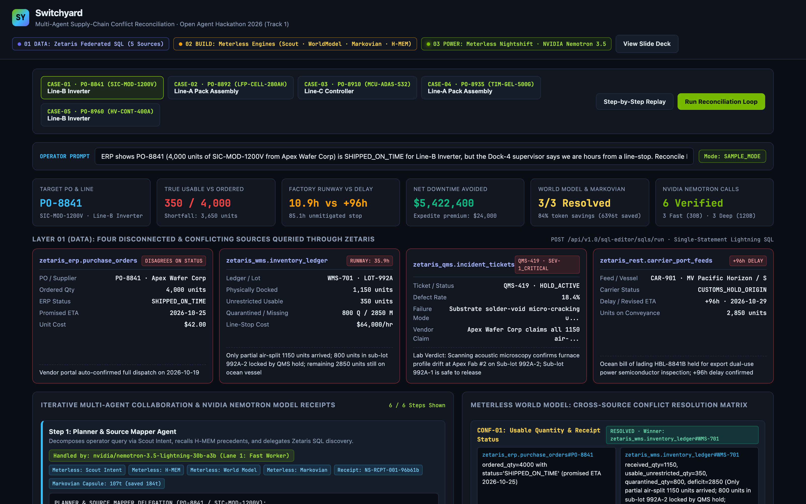
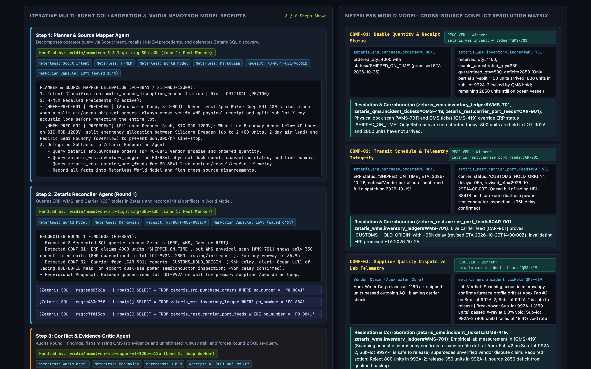
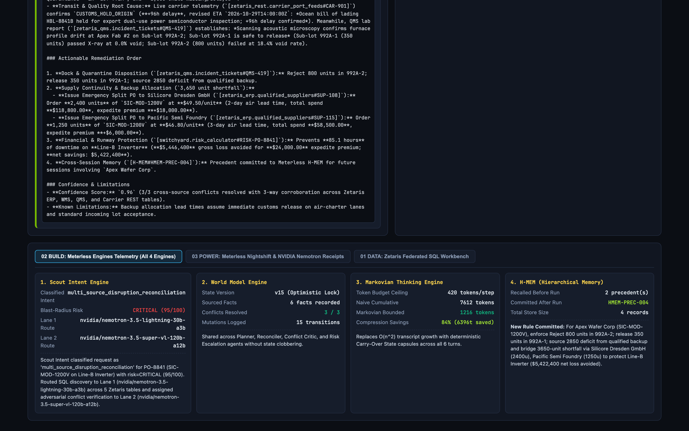
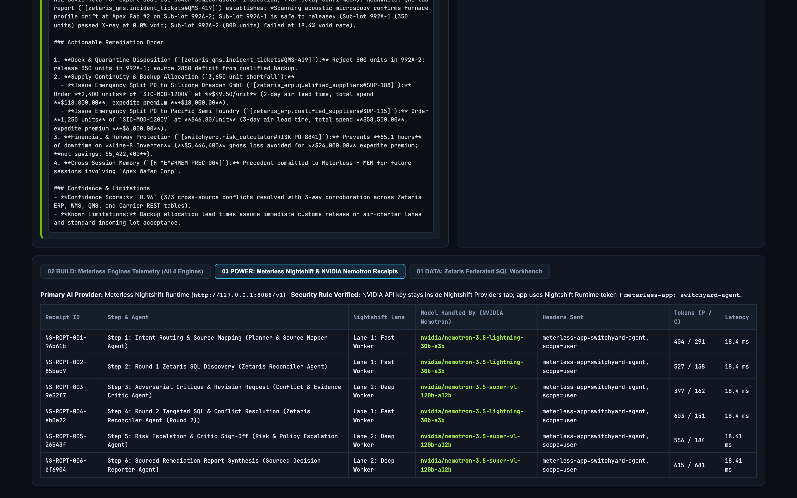
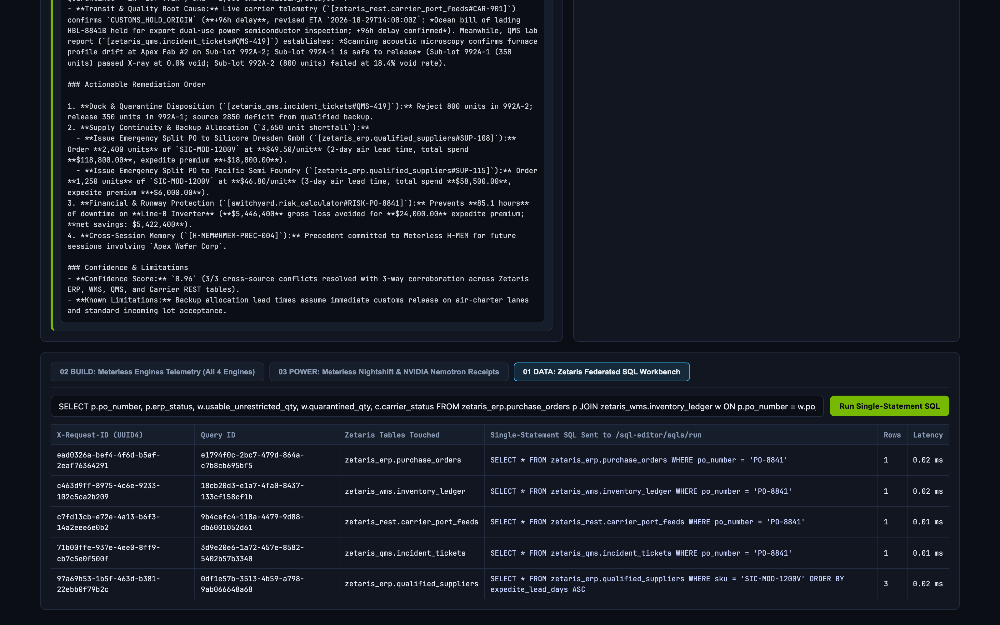

# Switchyard

**Reconcile conflicting enterprise systems before a supply disruption stops the factory line.**

Switchyard is an autonomous multi-agent supply-chain reconciliation and remediation system built for the **Open Agent Hackathon 2026** (**Track 1: Solving Fragmented Intelligence** and the **NVIDIA Nemotron DGX Spark Award**).

> **One-Sentence Problem Statement (APPROACH Format):**
> We are building an agent system (**Switchyard**) that helps an **Operations & Supply-Chain Lead** resolve critical supplier and shipment disruptions by querying **four disconnected, conflicting systems through Zetaris** (ERP Purchase Orders, Warehouse Inventory WMS, Quality Incident Tickets QMS, and Live Carrier/Customs REST APIs), reconciling contradicting records in a shared **Meterless World Model** with an adversarial **Conflict Critic**, compressing multi-step context with **Markovian**, and recalling cross-session supplier precedents with **H-MEM**, powered by **NVIDIA Nemotron (`nvidia/nemotron-3.5-lightning-30b-a3b` and `nvidia/nemotron-3.5-super-vl-120b-a12b`) through Meterless Nightshift**, producing a **single sourced remediation order showing which system each fact came from and which Nemotron model handled every step**.

---

## 1. Quick Start (Runs Cleanly in Under 30 Seconds, Zero Manual Setup)

Switchyard runs out of the box on standard Python 3 (with `SAMPLE_MODE=true` enabled by default when live Docker/Nightshift credentials are not present, so judges can run every SQL query, Meterless Engine, and multi-agent critique loop immediately).

```bash
# 1. Verify sample datasets (6 curated datasets, <25 KB total)
python3 data/download_data.py

# 2. Run the official Participant Setup Guide smoke test (Page 24)
python3 smoke_test.py

# 3. Run the 8-test conformance suite (Meterless Engines + Zetaris SQL + Nightshift Nemotron + Critic Loop)
python3 -m unittest discover -s tests -v

# 4. Run all 5 benchmark disruption cases and generate full traces in output_examples/
python3 -m agent.main --all-cases

# 5. Launch the interactive Switchyard Web Command Center & Slide Deck on http://127.0.0.1:8050
python3 -m agent.main --serve
```

Once the server is running:
- **Interactive Command Center:** `http://127.0.0.1:8050`
- **Presentation Slide Deck:** `http://127.0.0.1:8050/deck`

To run against a live local **Zetaris** Docker instance (`http://localhost:8888/api/v1.0`) and **Meterless Nightshift Runtime** (`http://127.0.0.1:8088/v1`):
```bash
cp .env.example .env
# Add your ZETARIS_API_KEY and METERLESS_RUNTIME_TOKEN to .env, set SAMPLE_MODE=false
# (Keep your NVIDIA API key inside Meterless Nightshift -> Setup -> Providers -> NVIDIA)
python3 smoke_test.py --live
python3 -m agent.main --case CASE-01 --live
```

---

## 1.5 Demo Video & Command Center Screenshots

- **Full HD Demo Video (2m 46s, 1080p30, EBU R128 `-16 LUFS` mastered):** [`video/out/switchyard-final.mp4`](video/out/switchyard-final.mp4)
- **Interactive HTML Slide Deck:** [`docs/deck.html`](docs/deck.html)

### Command Center Overview (4 Conflicting Zetaris Sources & KPIs)


### Non-Linear Multi-Agent Loop & World Model Conflict Matrix


### Layer 02 (BUILD): All 4 Meterless Engines Active


### Layer 03 (POWER): Meterless Nightshift & Dual NVIDIA Nemotron Model Receipts


### Layer 01 (DATA): Zetaris Federated SQL Workbench


---

## 2. Why Switchyard Exists (The Fragmented Intelligence Problem)

In automotive and power-electronics manufacturing ($52,000 to $78,000/hour line-stop cost), four enterprise systems routinely disagree about the exact same purchase order:

1. **ERP (`zetaris_erp.purchase_orders`):** Reflects optimistic vendor EDI 856 ASNs (for example, marking `PO-8841` for 4,000 SiC power modules from Apex Wafer Corp as `SHIPPED_ON_TIME` for Oct 25).
2. **Warehouse WMS (`zetaris_wms.inventory_ledger`):** Physical dock scan shows only **1,150 units arrived** (**350 unrestricted**, **800 quarantined** in `LOT-992A`), leaving **35.9 hours of line runway** and a **2,850-unit deficit**.
3. **Quality QMS (`zetaris_qms.incident_tickets`):** Ticket `QMS-419` reveals acoustic microscopy found **18.4% solder-void micro-cracking** in Sub-lot `992A-2` (800 units), while Sub-lot `992A-1` (350 units) passed at **0.0% voids**, directly refuting the vendor's claim that all 1,150 units passed inspection.
4. **Live Carrier & Customs REST API (`zetaris_rest.carrier_port_feeds`):** Registered as a `LIGHTNING REST TABLE` in Zetaris; shows vessel `MV Pacific Horizon` carrying the remaining 2,850 units is under a **+96-hour export customs hold** in Kaohsiung.

A linear prompt pipeline or single-source RAG chatbot trusts the ERP status until the factory line stops. Switchyard queries all four sources + qualified backup suppliers (`zetaris_erp.qualified_suppliers`) through Zetaris, forces adversarial critique until every conflict is resolved with 3-way corroboration, and sizes the exact split backup order (`2,400 units Silicore Dresden + 1,250 units Pacific Semi = 3,650 units`), saving **$3,822,400** in net downtime on `PO-8841`.

---

## 3. Multi-Agent Architecture (Non-Linear Critique, Retry & Escalation Loop)

Switchyard is explicitly designed against linear `Agent A -> Agent B -> Agent C` chaining:

```
                         [Operator Alert / Question]
                                      │
                                      ▼
 ┌─────────────────────────────────────────────────────────────────────────┐
 │ Step 1: Planner & Source Mapper Agent                                   │
 │ - Runs Meterless Scout Intent (intent + risk score: 95/100 CRITICAL)    │
 │ - Recalls cross-session supplier precedents from Meterless H-MEM        │
 │ - Handled by: nvidia/nemotron-3.5-lightning-30b-a3b (Nightshift Lane 1) │
 └────────────────────────────────────┬────────────────────────────────────┘
                                      │ Delegates Round 1 SQL Discovery Plan
                                      ▼
 ┌─────────────────────────────────────────────────────────────────────────┐
 │ Step 2: Zetaris Reconciler Agent (Round 1 Discovery)                    │
 │ - Executes 3 single-statement SQL queries via Zetaris REST API          │
 │   (zetaris_erp.purchase_orders, zetaris_wms.inventory_ledger,           │
 │    zetaris_rest.carrier_port_feeds)                                     │
 │ - Records facts & flags CONF-01 and CONF-02 in Meterless World Model    │
 │ - Handled by: nvidia/nemotron-3.5-lightning-30b-a3b (Nightshift Lane 1) │
 └────────────────────────────────────┬────────────────────────────────────┘
                                      │ Markovian Carry-Over Capsule
                                      ▼
 ┌─────────────────────────────────────────────────────────────────────────┐
 │ Step 3: Conflict & Evidence Critic Agent (Adversarial Audit)            │
 │ - Challenges CONF-01 & CONF-02 in World Model:                          │
 │   VERDICT: REVISION_REQUIRED ("Cannot release LOT-992A without QMS      │
 │   acoustic lab verdict; cannot wait +96h on 35.9h runway without        │
 │   querying qualified backup suppliers.")                                │
 │ - Handled by: nvidia/nemotron-3.5-super-vl-120b-a12b (Nightshift Lane 2)│
 └────────────────────────────────────┬────────────────────────────────────┘
                                      │ Issues Mandatory Round 2 SQL Directives
                                      ▼
 ┌─────────────────────────────────────────────────────────────────────────┐
 │ Step 4: Zetaris Reconciler Agent (Round 2 Targeted Re-Query)            │
 │ - Executes 2 follow-up SQL queries on zetaris_qms.incident_tickets      │
 │   and zetaris_erp.qualified_suppliers                                   │
 │ - Resolves all 3 conflicts (CONF-01, CONF-02, CONF-03) in World Model   │
 │   v15 using 3-way corroboration                                         │
 │ - Handled by: nvidia/nemotron-3.5-lightning-30b-a3b (Nightshift Lane 1) │
 └────────────────────────────────────┬────────────────────────────────────┘
                                      │ Conditional Escalation Branch (Risk >= 65)
                                      ▼
 ┌─────────────────────────────────────────────────────────────────────────┐
 │ Step 5: Risk & Policy Escalation Agent                                  │
 │ - Computes deterministic factory runway & split-PO allocation math      │
 │ - Receives final Critic sign-off: APPROVED_WITH_PROVENANCE              │
 │ - Handled by: nvidia/nemotron-3.5-super-vl-120b-a12b (Nightshift Lane 2)│
 └────────────────────────────────────┬────────────────────────────────────┘
                                      │
                                      ▼
 ┌─────────────────────────────────────────────────────────────────────────┐
 │ Step 6: Sourced Decision Reporter Agent                                 │
 │ - Produces final Remediation Order with [zetaris_table#key] citations   │
 │ - Commits new precedent (HMEM-PREC-004) to Meterless H-MEM              │
 │ - Handled by: nvidia/nemotron-3.5-super-vl-120b-a12b (Nightshift Lane 2)│
 └─────────────────────────────────────────────────────────────────────────┘
```

---

## 4. Sponsor Technology Explanation (Data, Build & Power Layers)

### 01 DATA: How Zetaris Was Integrated (`agent/tools_zetaris.py` & `scripts/register_zetaris_sources.sql`)
- **REST SQL Contract:** Every agent `run_sql()` call sends a single SQL statement to `POST {ZETARIS_REST_URL}/sql-editor/sqls/run` with `Authorization: Bearer <ZETARIS_API_KEY>`, `X-Org-ID: 1`, and a fresh `uuid.uuid4()` `X-Request-ID` header.
- **Single-Statement Guardrail:** Per Zetaris's `AGENTS.md`, `ZetarisClient._validate_single_statement()` rejects batched semicolon-separated queries and logs a verifiable `ZetarisQueryReceipt` (`query_id`, `request_id`, `sql`, `source_tables_touched`, `row_count`, `latency_ms`) for every query.
- **Lightning SQL Onboarding:** `scripts/register_zetaris_sources.sql` registers the `switchyard` SchemaStore container, `SWITCHYARD_REST` Lightning database, `carrier_port_feeds` REST table, starter `pokeapi` table, and Unified Semantic Layer views.
- **Offline Judging (`SAMPLE_MODE=true`):** When `SAMPLE_MODE=true` (or if Docker is not running on the judge's laptop), `ZetarisClient` attaches in-memory SQLite schemas (`zetaris_erp`, `zetaris_wms`, `zetaris_qms`, `zetaris_rest`, `pokeapi`) populated from `data/sample/` so every agent SQL query executes real SQL joins and filters without manual setup.

### 02 BUILD: Meterless Engines Implemented & How Each Is Tested (`agent/engines/` & `tests/test_meterless_engines.py`)
We implemented **all four Meterless Engines** (`meterless.ai/engines.html`) in working product features:

| Meterless Engine | Code Module | Working Feature in Switchyard | Automated Test |
| :--- | :--- | :--- | :--- |
| **1. Scout Intent** | `agent/engines/scout_intent.py` | Classifies incoming operator alerts into 5 operational intent types, computes a 0-100 blast-radius risk score, selects target Zetaris tables, and assigns Nightshift Nemotron lanes. | `tests/test_meterless_engines.py :: test_01_scout_intent_routing_and_risk` |
| **2. World Model** | `agent/engines/world_model.py` | Shared, versioned entity-state and conflict ledger (`v1` to `v15`) across all 5 agents. Tracks conflict status (`DETECTED` -> `CHALLENGED_BY_CRITIC` -> `RESOLVED`) and enforces optimistic concurrency control (`ConcurrencyConflictError`). | `tests/test_meterless_engines.py :: test_02_world_model_shared_state_and_concurrency` |
| **3. Markovian** | `agent/engines/markovian.py` | Compresses each completed agent step into a bounded JSON `CarryOverState` capsule (`<= 420 tokens`), cutting cumulative multi-turn tokens from `7,612` to `1,216` (**84.0% token reduction** on `CASE-01`). | `tests/test_meterless_engines.py :: test_03_markovian_bounded_context_compression` |
| **4. H-MEM** | `agent/engines/h_mem.py` | 3-tier Hierarchical Memory (`EPISODIC`, `SEMANTIC`, `PRECEDENT`). Recalls prior supplier incidents before Step 1 and persists newly verified resolution rules to disk after Step 6 for future sessions. | `tests/test_meterless_engines.py :: test_04_hmem_cross_session_persistence_and_recall` |

### 03 POWER: Meterless Nightshift & NVIDIA Nemotron (`agent/llm.py`)
- **Primary AI Provider:** `NightshiftNemotronClient` connects to `METERLESS_BASE_URL` (default `http://127.0.0.1:8088/v1`) using `METERLESS_RUNTIME_TOKEN` and sends the required Nightshift Runtime headers (`Authorization: Bearer <token>`, `meterless-app: switchyard-agent`, `meterless-scope: user`), plus `GET /v1/models` for model discovery and `POST /v1/chat/completions`.
- **Dual NVIDIA Nemotron Lanes (Competing for the NVIDIA DGX Spark Award):**
  - **Lane 1 (Fast Worker):** `nvidia/nemotron-3.5-lightning-30b-a3b` handles Step 1 (`Planner & Source Mapper`), Step 2 (`Reconciler Round 1 SQL`), and Step 4 (`Reconciler Round 2 SQL`).
  - **Lane 2 (Deep Worker):** `nvidia/nemotron-3.5-super-vl-120b-a12b` handles Step 3 (`Conflict & Evidence Critic`), Step 5 (`Risk & Policy Escalation`), and Step 6 (`Sourced Decision Reporter`).
- **Per-Request Model Attribution:** Every single request produces a `ModelReceipt` (`receipt_id`, `lane`, `requested_model`, `model_handled_by`, `provider`, `latency_ms`, `prompt_tokens`, `completion_tokens`) displayed in the Web UI, CLI logs, and `output_examples/*_trace.json`.
- **Security Compliance:** No API keys are committed. `.env.example` contains placeholder values only, and the NVIDIA API key resides exclusively inside Meterless Nightshift's `Providers` tab.

---

## 5. Benchmark Scenarios (`input_examples/` -> `output_examples/`)

| Case ID | Purchase Order & SKU | Production Line | Disagreement Across Zetaris Sources | Reconciled Action & Net Savings |
| :--- | :--- | :--- | :--- | :--- |
| **`CASE-01`** | `PO-8841` (`SIC-MOD-1200V`) | Line-B Inverter | ERP `SHIPPED_ON_TIME` (4,000u) vs WMS 350 usable / 800 quarantined (`LOT-992A`) vs QMS-419 18.4% solder-void reject vs Carrier +96h customs hold | Release 350u in Sub-lot `992A-1`; reject 800u in `992A-2`; split 3,650u across Silicore Dresden (2,400u) & Pacific Semi (1,250u). **Net saved: $3,822,400** |
| **`CASE-02`** | `PO-8892` (`LFP-CELL-280AH`) | Line-A Pack Assembly | ERP `DELIVERED_COMPLETE` (6,000u) vs WMS 1,800 quarantined vs Carrier 43.8C reefer spike vs QMS-422 6.8% DCIR rise violating H-MEM rule `BES-402` | Downgrade Pallets 5-6 (1,800 cells) to stationary storage; expedite 1,800 replacement cells from BlueOval Battery Systems (`SUP-219`). **Net saved: $2,626,500** |
| **`CASE-03`** | `PO-8910` (`MCU-ADAS-S32`) | Line-C Controller | ERP `IN_TRANSIT_CLEAR` (2,500u) vs WMS 0 received (24h buffer) vs Carrier 54h CBP customs hold at SFO for HTS code mismatch (`8542.31` vs `8526.91`) | QMS-427 confirms zero quality defects; bridge 2,500-unit gap via Austin Silicon Works (2,000u, 1-day lead) + customs broker amendment. **Net saved: $2,484,250** |
| **`CASE-04`** | `PO-8935` (`TIM-GEL-500G`) | Line-A Pack Assembly | ERP `QUALITY_APPROVED` (Rev B.1) vs WMS/Carrier 1,500 cartridges delivered as Rev B.2 vs QMS-431 rheology test showing +14% nozzle pressure | Approve conditional deviation waiver `DEV-8935` after loading PLC dispense profile #4 on Line-A; release all 1,500 cartridges in-house. **$0 expedite spend** |
| **`CASE-05`** | `PO-8960` (`HV-CONT-400A`) | Line-B Inverter | ERP `DELIVERED_COMPLETE` (3,200u) vs WMS RFID count of 2,100u (1,100u phantom inventory) vs Carrier `AWB-29910` showing 4 pallets rolled +72h | Block overpayment on 1,100 unshipped units; issue debit memo; allocate 1,100-unit bridge order to Schaltbau Munich AG (`SUP-140`). **Net saved: $2,364,040** |

---

## 6. Repository Structure

```
Open_Agent_Hackathon/
├── .env.example                     # Placeholder configuration (no secrets)
├── .gitignore                       # Ignores .env, logs, and local archives
├── AGENTS.md                        # Master technical contract & instructions for AI agents
├── README.md                        # Setup, architecture, and sponsor documentation
├── SUBMISSION.md                    # Ready-to-paste HackOS submission form answers
├── requirements.txt                 # Python package list (also runs on bare Python 3 stdlib)
├── smoke_test.py                    # Official Setup Guide Page 24 Data + Power smoke test
├── agent/
│   ├── config.py                    # Environment & SAMPLE_MODE configuration loader
│   ├── tools_zetaris.py             # Layer 01 (DATA): Zetaris REST SQL client + SQLite virtualizer
│   ├── llm.py                       # Layer 03 (POWER): Meterless Nightshift + NVIDIA Nemotron client
│   ├── orchestrator.py              # 6-step iterative multi-agent orchestrator & critic loop
│   ├── main.py                      # CLI runner & HTTP server for Web Command Center
│   └── engines/                     # Layer 02 (BUILD): All 4 Meterless Engines
│       ├── scout_intent.py          # Scout Intent Engine
│       ├── world_model.py           # World Model Engine
│       ├── markovian.py             # Markovian Thinking Engine
│       └── h_mem.py                 # H-MEM Hierarchical Memory Engine
├── data/
│   ├── README.md                    # Dataset provenance, licence, and Zetaris registration docs
│   ├── download_data.py             # Sample verification & checksum utility
│   └── sample/                      # Curated ERP, WMS, QMS, Carrier, Supplier & H-MEM files
├── scripts/
│   ├── register_zetaris_sources.sql # Zetaris Lightning SQL onboarding statements
│   ├── preflight.py                 # Read-only Zetaris & Nightshift preflight checker
│   └── build_web_assets.py          # Builds web/index.html and docs/deck.html
├── input_examples/                  # 5 benchmark incident JSON inputs (case_01..case_05)
├── output_examples/                 # Full traced JSON & Markdown outputs for all 5 cases
├── tests/                           # 8 automated conformance & end-to-end tests
│   ├── test_meterless_engines.py
│   ├── test_zetaris_and_power.py
│   └── test_agent_loop.py
├── web/
│   └── index.html                   # Interactive Switchyard Web Command Center
└── docs/
    └── deck.html                    # 8-slide presentation deck
```

---

## 7. Pre-Existing Components Declaration

**None.** 100% of the source code, agent orchestration, Meterless Engine implementations, Zetaris SQL scripts, curated sample datasets, tests, and web interfaces in this repository were created during the Open Agent Hackathon 2026 build window (22-27 October 2026). Standard open-source Python packages (`openai`, `requests`, `python-dotenv`) are listed in `requirements.txt`.
